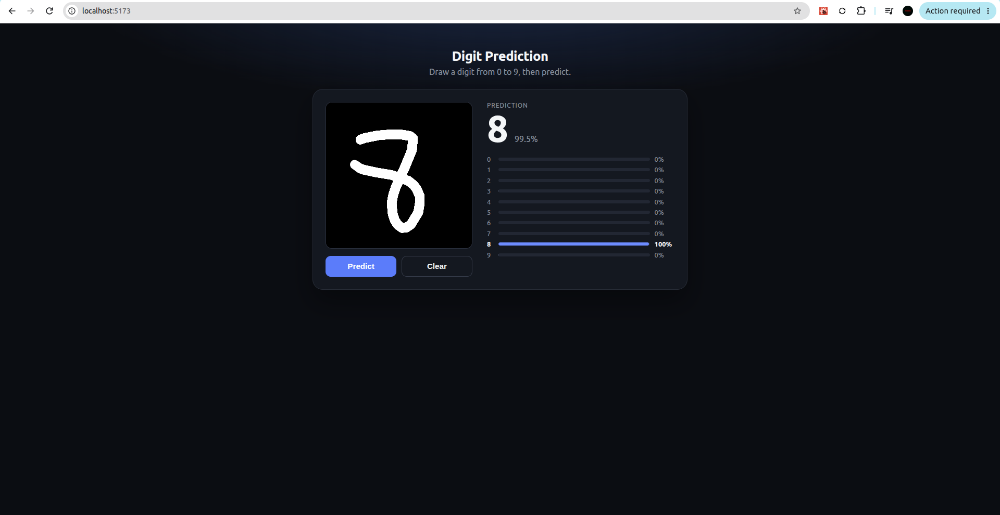

# Number Prediction

Draw a digit in the browser and get a live prediction from a small ANN trained on MNIST
(replicated from the original notebook: `Flatten -> Dense(100, relu) -> Dense(30, relu) -> Dense(10, softmax)`).

## Project layout

```
ml/         modular training/inference pipeline (data.py, model.py, train.py, predict.py)
server/     FastAPI app exposing POST /predict
frontend/   React (Vite) UI with a drawing canvas
models/     trained model artifact (digits_intel.keras)
```

## 1. Train the model

```bash
python3 -m venv .venv
source .venv/bin/activate
pip install -r requirements.txt
python -m ml.train
```

This downloads MNIST, trains for 10 epochs, and saves `models/digits_intel.keras`.

## 2. Run the API

```bash
source .venv/bin/activate
uvicorn server.main:app --reload --port 8000
```

## 3. Run the UI

```bash
cd frontend
npm install
npm run dev
```

Open the printed localhost URL, draw a digit, and click **Predict**.

## Screenshot



## More details

See [explaination.md](explaination.md) for a step-by-step walkthrough of the
training pipeline and what each stage does.
